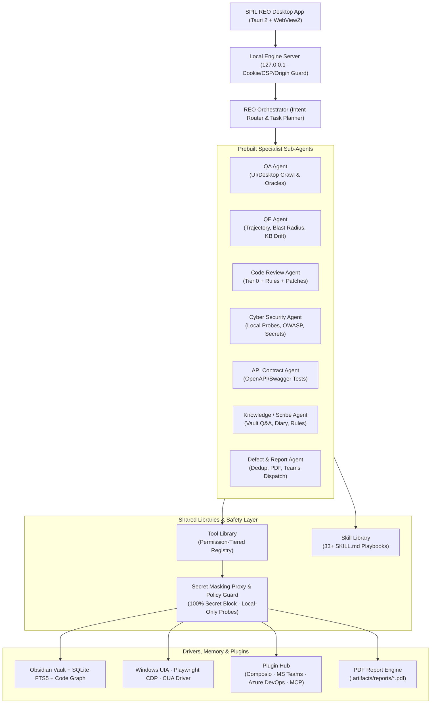

# SPIL REO — Product Architecture, Multi-Agent System & UI Blueprint

> **SPIL REO** — *REVIEW · EVALUATE · OPTIMIZE*  
> **Autonomous Engineering Intelligence.**  
> *A Multi-Agent Quality Engineering & Software Assurance Platform.*  
> **POWERED BY SPIL LABS**

---

## 1. System Architecture Overview

---

## 2. Multi-Agent Architecture, Tool Library & Skill Library

### 2.1 The REO Orchestrator (Main Agent)
- **Role:** Single entry point for all user requests. Classifies intent, checks safety/masking, selects one or more specialist sub-agents, coordinates parallel or sequential steps, and merges results into one clean response.
- **Smart Routing Rule (Landing → Main Chat):**
  - **Knowledge / Explanation** prompt on the Landing page (e.g., *"How does order routing work?"*, *"What is our rule for ERP writes?"*) → **Knowledge Agent** answers right there on the Landing page with Vault/Code citations.
  - **QA, QE, Code Review, Security, Crawling, or Automation** prompt (e.g., *"QA this branch"*, *"Run security probes on localhost:3000"*, *"Review PR 123"*) → **Orchestrator automatically hands off and redirects** the prompt into the **Main Chat Workspace**, spinning up the required sub-agents with live step tracking.

### 2.2 Prebuilt Specialist Sub-Agents
Each sub-agent is defined as a declarative config (`roles/agents/<id>.json`) with its own **allowed tools**, **default skills**, **safety tier**, and **output schema**:

| Sub-Agent | Specialty | Core Tools Used | Output Artifacts |
|---|---|---|---|
| **QA Agent** | Live UI & Desktop testing, journey generation, visual & console/network oracles | Windows UIA Crawler, Playwright CDP, CUA Driver, Oracles | Pass/Fail runs, screenshots, console/network logs, new Defects |
| **QE Agent** | Engineering health: commit trajectory, churn hotspots, blast radius, KB drift, test selection | Git log/diff, Graphify AST graph, Co-change index, Constraint advisor | Risk score, impacted areas, regression test shortlist |
| **Code Review Agent** | Tier 0 static defect checks + active Vault rules + semantic diff review | Tier 0 AST/regex rules, Vault rules, Diff reader | Blocker/Risk/Suggestion findings + copyable fix patches |
| **Cyber Security Agent** | OWASP Top 10, local-only adversarial probes (SQLi, XSS, IDOR, path traversal, headers, DoS cap), secret & dependency audit | Local HTTP probe runner, Masking scanner, Security skills | Security findings (CVSS/Severity), proof-of-concept payloads, remediation |
| **API & Contract Agent** | OpenAPI/Swagger parsing, positive/negative/boundary API tests, response schema drift | OpenAPI parser, Safe local HTTP client | Endpoint coverage matrix, schema drift defects |
| **Knowledge / Scribe Agent** | Vault Q&A with citations, daily engineering diary, stale-note detection, choice mining | SQLite FTS5, Vault reader/drafter, Session miner | Cited answers, proposed vault notes, daily diary |
| **Report & Triage Agent** | Defect fingerprinting (SHA-256 dedup), severity grouping, PDF generation, Teams notifications | Defect DB, PDF generator, MS Teams connector | Branded PDF report, Teams adaptive card draft |

### 2.3 Tool Library (`engine/src/tools/registry.ts`)
- Central registry for all built-in, MCP, and Composio tools.
- **Metadata per tool:** `id`, `name`, `category` (`repo`, `vault`, `ui-driver`, `security`, `api`, `report`, `plugin`), `riskTier` (`read_only` | `local_action` | `external_notify` | `blocked`), `requiresConfirmation` (`boolean`), `inputSchema` (Zod).
- **Safety Enforcement:** Policy engine enforces `riskTier` at runtime — `external_notify` (e.g., sending a Microsoft Teams message) or `local_action` (e.g., live UIA clicks) always obeys human-in-the-loop approval and never touches production or ERP write endpoints.

### 2.4 Skill Library (`plugin/aura-guard/skills/` + Custom Skills)
- Houses the **33+ built-in `SKILL.md` playbooks** (DevSecOps, QA, QE, Lauren Poteto Rules, PR Advisor, etc.) plus custom company skills.
- Any sub-agent can load matching skills dynamically, or the user can explicitly invoke one in chat with `#skill-name` (e.g., `#sec-api-input`, `#qa-accessibility-responsive`).

---

## 3. Complete UI Sitemap (Pages, Sections & Parts)

### Global App Chrome
- **Left Navigation Rail (Collapsible):**
  1. **Home** — Clean Landing & Quick Knowledge Chat
  2. **Workspace** — Main Multi-Agent Chat & Automation Studio
  3. **Defects** — Defect Tracker, Evidence Gallery, PDF Reports & Teams Dispatch
  4. **Plugins** — Composio, MS Teams, Azure DevOps, GitHub, MCP Hub
  5. **Agents & Skills** — Sub-Agent Roster, Tool Library, Skill Library
  6. **Knowledge** — Vault Explorer, Proposed Rules Inbox, How REO Works Guide
  7. **Settings** — Themes, Models/Keys, Team Directory, Safety & Repos
- **Top Status Strip (44px):** Global Quick Search (`Ctrl+K`), Engine Health dot (`Engine connected`), Active Background Jobs indicator, Inbox notification badge, Theme quick-toggle.

---

### Page 1: Landing / Home (`Home`)
**Goal:** Ultra-clean, distraction-free entry screen for general knowledge Q&A and instant launch into automations.

- **Section 1.1 — Hero Header:**
  - Badge: `SPIL REO · REVIEW · EVALUATE · OPTIMIZE`
  - Headline: *"Autonomous Engineering Intelligence"*
  - Subtext: *"Ask anything from your vault and codebase — or launch QA, QE, Code Review, and Security agents."*
- **Section 1.2 — Simple Knowledge Chat Box:**
  - Single centered, elevated input box with placeholder: *"Ask a question about SPIL AURA, or tell REO what to QA, review, or audit..."*
  - Minimal controls: `Notes only` toggle + Send button.
  - **Smart Redirect Banner:** Operational/QA/review/security prompts show a smooth handoff pill (*"Routing to QA & Code Review Agents in Workspace..."*) and automatically open **Page 2 (Workspace)** with the prompt executing.
- **Section 1.3 — Inline Quick Answer Drawer (Knowledge Only):**
  - Pure knowledge answers render cleanly below the box with clickable source chips and a *"Continue in Workspace →"* button.
- **Section 1.4 — Subtle Quick-Link Footer:**
  - Compact live repo/vault health pills (`5 repos · 32 notes · 223 files`) + **`How REO Works →`**.

---

### Page 2: Main Chat Interface (`Workspace`)
**Goal:** Primary multi-agent command center where all chatting and automations happen — clean, spacious, zero clutter.

- **Part 2.1 — Left Chat History Sidebar (Collapsible):**
  - `+ New Chat` primary button
  - Search chats input
  - Grouped chat list (`Today`, `Yesterday`, `Earlier`) with agent-type indicator dots
- **Part 2.2 — Main Conversation Canvas:**
  - **Clean Empty State:** `SPIL REO` motto pill + short heading + 4 compact action pills (`QA this branch`, `Code Review`, `Security Audit`, `QE Trajectory`). No robot mascot or dashboard cards.
  - **Multi-Agent Execution Cards (Inside Chat Stream):**
    - Shows invoked sub-agent(s) (`QA Agent`, `Code Review Agent`, `Cyber Security Agent`).
    - Collapsible **Live Step Timeline** (`Understanding` → `Targeting branch` → `Running UIA Crawler` → `Running Oracles` → `Generating Defects`).
    - **Live Control Strip** while running: `Pause` | `Step` | `Inject Hint` | `Abort`.
    - Inline **Evidence Previews** (thumbnail screenshots, defect count pill linking to **Defects**, copyable code fix diffs).
- **Part 2.3 — Smart Multi-Agent Composer:**
  - Supports `/commands` (slash menu), `@agent` (target a specific sub-agent like `@security` or `@qa`), and `#skill` (attach a skill from the Skill Library).
  - Compact bottom bar: `Show work` toggle, `Notes only` toggle, active Model chip, Send / Stop button.
- **Part 2.4 — Right Contextual Inspector Drawer (Hidden until opened):**
  - Tabs: **Sources** (Vault notes & code snippets) | **Live Evidence** (Screenshots, ARIA tree, Console/Network errors) | **Tool Calls** (Raw JSON input/output).

---

### Page 3: Defects & Reports (`Defects`)
**Goal:** Central repository of every defect discovered by QA, Code Review, API, and Security agents, with **PDF report generation** and **Microsoft Teams engineer dispatch**.

- **Section 3.1 — KPI & Filter Header:**
  - Summary counters: `Total Open`, `Critical / High`, `Code Review Fixes`, `Sent to Team`, `Resolved`.
  - Filters: **App Name**, **Branch Name**, **Tested By**, **Date Range**, **Agent Source** (`QA` / `Review` / `Security` / `API`), **Severity**, **Status**.
  - Primary Action Buttons: **`Export PDF Report`** | **`Send to Teams`**.
- **Section 3.2 — Defects Table / List:**
  - Columns: Checkbox, `ID / Fingerprint`, `Defect Title & Severity Badge`, `App Name` & `Branch Name`, `Tested Date` & `Tested By`, `Assigned Engineer` (auto-suggested from git history, editable), `Evidence Count`, `Status` (`Open`, `Triaged`, `Notified`, `Fixed`, `False Positive`).
- **Section 3.3 — Defect Detail Slide-Over / Split View:**
  - **Metadata Header:** App Name, Branch, Commit SHA, Tested Date, Tested Person, Agent Source, Environment.
  - **What Happened:** Expected vs. Actual behavior + Reproduction Steps.
  - **Code Review Suggestions & Patch:** File/line reference, root cause, syntax-highlighted suggested code fix + 1-click Copy Patch.
  - **Visual Evidence & Snapshots Gallery:** Full-resolution screenshots/snaps (lightbox zoom), console errors, failed network XHR/Fetch traces.
  - **Triage & Dispatch Actions:** `Mark Real Bug` / `Mark Flaky` / `Mark Fixed`, **`Download Single PDF`**, **`Send to Engineer on Teams`** (preview modal: pick recipient from Team Directory, edit note, attach PDF/summary card, confirm send).
- **Section 3.4 — PDF Report Generator Spec:**
  - Print-grade HTML-to-PDF rendered via Playwright `page.pdf()` (already in the stack).
  - Includes: **SPIL REO** cover header (*Powered by SPIL Labs*), App/Branch/Tester/Date metadata, Executive Severity Summary, Full Defect Cards with embedded screenshots, Code Review Patch Suggestions, and Sign-off footer.

---

### Page 4: Plugins & Integrations (`Plugins`)
**Goal:** Connect external ecosystems cleanly with encrypted credential storage.

- **Section 4.1 — Featured Connectors Grid:**
  - **Composio:** Connect Composio API key to unlock 100+ OAuth-managed toolkits (Jira, Linear, Slack, GitHub, Notion, Google Workspace) and expose selected actions into REO's **Tool Library**.
  - **Microsoft Teams:** Incoming Webhooks, Power Automate Workflow URL, or Microsoft Graph / Teams Bot credentials to send Defect Reports and direct messages to mapped engineers.
  - **Azure DevOps / GitHub:** Read-only PR diff & thread sync, work-item draft export.
  - **MCP Server Hub:** Add external stdio/SSE MCP servers (auto-discovers tools into Tool Library) + view connection string to plug REO's MCP server into Claude Code / VS Code / Cursor.
  - **Local Automation Drivers:** Live health cards for `Windows UIA Crawler`, `Playwright CDP`, and `CUA Driver`.
- **Section 4.2 — Plugin Configuration Drawer:**
  - Encrypted API key / OAuth setup (Windows DPAPI, never plaintext).
  - **Permission Scope Switcher:** `Read-Only` vs. `Notify (Requires Confirmation)`.
  - `Test Connection` button with live latency & status feedback.

---

### Page 5: Agents, Tools & Skills (`Agents & Skills`)
- **Tab 5.1 — Sub-Agents Roster:** Manage all 7 prebuilt agents (`QA`, `QE`, `Code Review`, `Cyber Security`, `API Contract`, `Knowledge/Scribe`, `Report/Triage`) — toggle On/Off, model override per agent, assigned tools & skills, or **+ Create Custom Agent**.
- **Tab 5.2 — Tool Library:** Searchable table of all built-in + MCP + Composio tools with category, risk tier, and confirmation requirement.
- **Tab 5.3 — Skill Library:** Browse all **33+ `SKILL.md` skills** by category (`Security`, `QA`, `QE`, `Engineering`), read instructions, toggle active/inactive, or **+ New Skill**.

---

### Page 6: Knowledge & Guide (`Knowledge`)
- **Tab 6.1 — Review Inbox:** Approve / Dismiss / Undo proposed vault rules, choice records, and stale-note alerts.
- **Tab 6.2 — Vault Explorer:** Searchable browser of active Obsidian vault notes, ADRs, and code anchors.
- **Tab 6.3 — How REO Works:** Interactive guide explaining the 3 pillars (**Review · Evaluate · Optimize**), safety boundaries, keyboard shortcuts, and live repository KPIs.

---

### Page 7: Settings (`Settings`)
1. **Appearance & Themes:** Light / Dark / System mode, Theme preset (`Emerald Clean`, `Zinc`, `Cosmic Dark`), font density, reduced motion.
2. **AI Models & Keys:** Backend selection (`Claude API`, `Claude CLI Plan`, `Local Ollama/llama.cpp`), encrypted DPAPI API key store, per-agent model overrides, `Test Model` button.
3. **Team Directory & MS Teams Routing:** Map engineers (`Display Name`, `Git Author / Email`, `Role / Module Ownership`, `MS Teams User ID / Email or Channel Webhook`), default report template, *"Always ask before sending Teams messages"* (ON by default).
4. **Projects & Repositories:** Local repo paths (`guard.config.local.json`), default branches, allowed localhost test URLs, allowed Windows UIA window titles.
5. **Security & Guardrails:** Secret masking status & test button, read-only repo lock, ERP write block status, resource guard memory threshold.
6. **Storage & Maintenance:** Vault path, `Rebuild SQLite Index`, `Refresh Code Graph`, `.artifacts/` cleanup, export/backup settings.

---

## 4. Data & Storage Model

- **SQLite (`data/guard.db`):**
  - Existing tables: `docs`, `commits`, `notes`, `cochange`, `graph_nodes`, `graph_edges`.
  - New tables:
    - `defects` (`id`, `fingerprint`, `app_name`, `branch`, `commit_sha`, `tested_date`, `tested_by`, `assigned_to`, `agent_source`, `severity`, `status`, `title`, `expected`, `actual`, `repro_steps_json`, `code_suggestion_json`, `evidence_paths_json`, `sent_teams_at`)
    - `team_members` (`id`, `name`, `git_aliases_json`, `email`, `teams_target`, `modules_json`)
    - `plugins` (`id`, `kind`, `enabled`, `config_json`, `status`, `last_tested_at`) — *secrets stored separately in Windows DPAPI `data/secrets/<plugin-id>.dpapi`, never in SQLite*
- **Files on Disk:**
  - `.artifacts/qa/<runId>/` — screenshots, network/console logs, raw bug sheets.
  - `.artifacts/reports/SPIL-REO-Report-<app>-<branch>-<date>.pdf` — generated PDF reports.

---

## 5. Phased Implementation Roadmap

| Phase | Scope | Key Deliverables |
|---|---|---|
| **Phase 1 — Navigation, Landing & Clean Workspace** | Refactor UI shell to the 7-page sidebar (`Home`, `Workspace`, `Defects`, `Plugins`, `Agents & Skills`, `Knowledge`, `Settings`) | Smart intent redirect from Landing Knowledge Chat → Main Workspace; `@agent` & `#skill` pickers; clean multi-agent step cards |
| **Phase 2 — Orchestrator, Tool Library & Sub-Agent Registry** | Formalize `engine/src/agents/` + `engine/src/tools/` | Unified registry for all 7 prebuilt sub-agents, permission-tiered Tool Library, and Agents & Skills UI page |
| **Phase 3 — Defects Page & PDF Report Engine** | Build `defects` SQLite persistence + `Defects` UI + Playwright PDF generator | Full filterable Defects table, detail drawer with screenshots & code review patches, 1-click branded **SPIL REO PDF Report** download |
| **Phase 4 — Plugins Hub (Composio + MS Teams) & Settings** | Build `engine/src/plugins/` + DPAPI multi-secret store + Team Directory | Composio toolkit bridge into Tool Library, MS Teams webhook/Graph dispatch from Defects page, full categorized Settings page |
